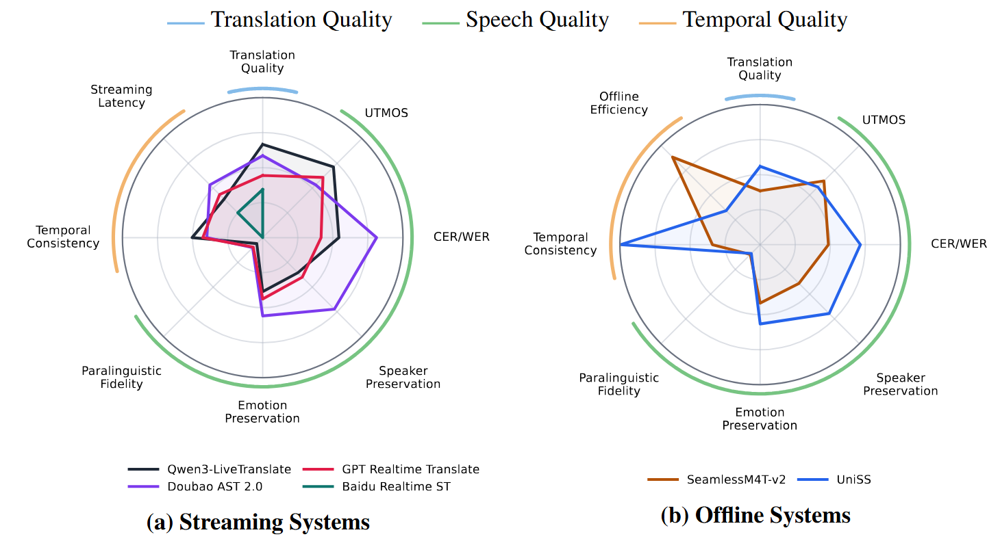

# OpenSTBench

[English](./README.md) | 中文

[](https://arxiv.org/abs/2605.30792)
[](https://pypi.org/project/OpenSTBench/)
[](https://www.python.org/downloads/)
[](LICENSE)
[](https://github.com/sjtuayj/OpenSTBench)
[](https://x-lance.sjtu.edu.cn/)

OpenSTBench 是一个面向语音翻译的多维度评测工具包，适用于异构语音翻译系统，包括语音到文本翻译（S2TT）、语音到语音翻译（S2ST）、离线系统和流式系统。

工具包按三个维度组织评测：

- **翻译质量**：评估译文是否准确表达源语音的语义内容。
- **语音质量**：评估生成语音的自然度、文本一致性、说话人保持、情感保持，以及声学事件保持。
- **时序质量**：评估生成语音是否保持合理的时长结构，并在流式系统中评估响应延迟。

## 安装

```bash
pip install OpenSTBench
```

本地开发安装：

```bash
git clone https://github.com/sjtuayj/OpenSTBench.git
cd OpenSTBench
conda create -n openstbench python=3.10 -y
conda activate openstbench
pip install -e .
```

可选依赖：

```bash
pip install "OpenSTBench[comet]"
pip install "OpenSTBench[whisper]"
pip install "OpenSTBench[tokenizer-ja]"  # 日语 BLEU
pip install "OpenSTBench[tokenizer-ko]"  # 韩语 BLEU
pip install "OpenSTBench[speech_quality]"
pip install "OpenSTBench[emotion]"
pip install "OpenSTBench[acoustic-events]"
pip install "OpenSTBench[metricx]"
pip install "OpenSTBench[all]"
```

MetricX 遵循官方 `google-research/metricx` 运行环境要求。安装
`OpenSTBench[metricx]` 或 `OpenSTBench[all]` 时会固定 MetricX 兼容依赖，
包括 `transformers[torch]==4.30.2`、`sentencepiece==0.1.99`、
`datasets==2.13.1`、`protobuf==3.20.3` 和 `accelerate>=0.26.0`。

BLEURT 需要单独安装：

```bash
pip install git+https://github.com/lucadiliello/bleurt-pytorch.git
```

## 包名

- PyPI 包名：`OpenSTBench`
- Python 导入名：`openstbench`

## 评测维度

| 维度 | 评测器 | 系统类型 | 主要输出 |
| :--- | :--- | :--- | :--- |
| 翻译质量 | `TranslationEvaluator` | S2TT、S2ST 文本或生成语音 | `sacreBLEU`, `chrF++`, `COMET`, `BLEURT`, `MetricX`, `MetricX_QE` 及对应的 `ASR_` 指标 |
| 语音质量 | `SpeechQualityEvaluator` | S2ST | `UTMOS`, `WER_Consistency`, `CER_Consistency` |
| 语音质量 | `SpeakerSimilarityEvaluator` | S2ST | `average_wavlm_large_similarity`, `average_resemblyzer_similarity` |
| 语音质量 | `EmotionEvaluator` | S2ST | `Emotion2Vec_Cosine_Similarity`, `Audio_Emotion_Accuracy` |
| 语音质量 | `AcousticEventEvaluator` / `BEATsStrongEventDetector` | S2ST | `event_content_map` |
| 时序质量 | `TemporalConsistencyEvaluator` | S2ST | `Duration_Consistency_SLC_0.2`, `Duration_Consistency_SLC_0.4` |
| 时序质量 | `LatencyEvaluator` | 流式 S2TT/S2ST | `First_Audio_Delay_(StartOffset_ms)`, `Overall_Translation_Delay_(ATD_ms)`, `End_Action_Delay_(CustomATD_ms)`, `Real_Time_Factor_(RTF)` |

离线和流式是系统设置，不是独立的指标维度。请根据系统实际输出选择对应评测器：文本、生成语音、源/目标语音对、事件标注或流式轨迹。

### 声学事件评测

声学事件评测用于判断目标音频是否保留了源音频标注的事件类别，不评测事件发生的时间位置。OpenSTBench 直接使用公开的 `BEATs_strong_1` checkpoint，不需要训练或微调，并计算无人工检测阈值的 clip-based 宏平均 Average Precision（`event_content_map`）。只有在当前评测 cohort 中同时具有正例和负例的类别才进入宏平均。

公共 `AcousticEventEvaluator` 和 `compute_event_content_map` API 直接返回 Content mAP 结果，其中包含整体 `event_content_map`、逐类 AP、正负样本数和类别覆盖率。可运行示例见 [`examples/python/acoustic_event_eval.py`](examples/python/acoustic_event_eval.py)。

`newtest` 流程将结果写入 `metrics_acoustic_events.json`，其中包含两个指标视图和独立的 coverage：

- `metrics.successful_only.event_content_map` 是在成功生成的目标音频上计算的正式指标。
- `metrics.all_samples_zero_scored.event_content_map` 仅用于诊断；失败目标音频的所有事件类别置信度记为零，然后在完整 cohort 上重新计算 mAP。
- `coverage` 报告成功率、失败率和失败原因。

运行 `newtest/eval/eval_acoustic_events.py` 时，不传 `--beats_model_path` 会把固定 checkpoint 下载到 OpenSTBench 用户缓存；也可以显式传入 checkpoint 路径。该流程没有训练命令，也没有人工检测阈值。

## 实验结果概览

下方雷达图展示了 OpenSTBench 对代表性流式和离线语音翻译系统给出的多维评测视角。该图概括了系统在翻译质量、语音质量和时序质量上的差异：即使系统具有较强的翻译质量，也可能在语音实现、说话人或情感保持、副语言事件保真、时长一致性，以及延迟或效率方面呈现不同表现。



## 论文使用的数据集

论文中使用了以下数据集。使用时请遵守各原始数据集的许可证和访问条款。

| 数据集 | 用途 | 链接 |
| :--- | :--- | :--- |
| MSLT dev | 翻译质量、语音质量、时长一致性、延迟 | [Microsoft Speech Language Translation Corpus](https://www.microsoft.com/en-us/download/details.aspx?id=54689) |
| LibriTTS-based paired speaker set | 说话人保持 | OpenSTBench 构造的 paired set 已发布在 [Hugging Face Datasets](https://huggingface.co/datasets/ayj111/openstbench-paired-set)；源语料为 [LibriTTS](https://www.openslr.org/60/) |
| RAVDESS | 情感保持 | 使用 RAVDESS Zenodo 记录中的 [Audio_Speech_Actors_01-24.zip](https://zenodo.org/records/1188976) 压缩包 |
| MCAE-SPPS | 情感保持 | [MCAE-SPPS on OSF](https://doi.org/10.17605/OSF.IO/9JYZC) |
| NonverbalTTS test | 声学事件内容 | [deepvk/NonverbalTTS](https://huggingface.co/datasets/deepvk/NonverbalTTS) |
| SynParaSpeech | 声学事件内容 | [shawnpi/SynParaSpeech](https://huggingface.co/datasets/shawnpi/SynParaSpeech) |

## 快速开始

```python
from openstbench import TranslationEvaluator

evaluator = TranslationEvaluator(
    use_bleu=True,
    use_chrf=True,
    use_comet=False,
    use_bleurt=False,
    use_metricx=True,
    device="cuda",
)

scores = evaluator.evaluate_all(
    reference=["我喜欢看电影。", "今天天气很好。"],
    target_text=["我喜欢看电影。", "今天天气很好。"],
    source=["I like watching movies.", "The weather is nice today."],
    target_lang="zh",
    asr_text=["我喜欢看电影。", "今天天气很好。"],
)

print(scores)
```

ASR 翻译质量评测默认开启，但只有传入 `target_audio` 或预先生成的
`asr_text` 时才会执行。若要直接转写生成语音，可将单个音频、音频路径列表或
音频目录传给 `target_audio`；Whisper 默认使用 `medium`，可通过
`TranslationEvaluator(whisper_model="large-v3")` 更换。设置
`use_asr=False` 可关闭全部 `ASR_` 指标。

需要为不同语言选择不同 ASR 时，可配置语言路由：

```python
from openstbench import ASRRouter, TranslationEvaluator, WhisperASRBackend

router = ASRRouter({
    "default": WhisperASRBackend(model="medium"),
    "ja": WhisperASRBackend(model="large-v3"),
})
evaluator = TranslationEvaluator(asr_router=router)
```

粤语应保留为独立路由 `"yue"`；如果所选 Whisper checkpoint 不支持粤语，
请配置粤语 `ASRBackend`，或直接提供预计算的 `asr_text`。宗卡语 `"dz"`
同样使用字符 BLEU/CER，但默认 Whisper 后端需要替换为自定义 ASR，或使用
`asr_text`。延迟评测需要按语言自动分词时，可使用
`--target-language ja --latency-unit auto`；不选择 `auto` 时保持原有显式单位行为。

### 多语种快速开始

`target_lang` 是翻译质量和语音文本一致性评测的语言开关。评测日语或韩语
BLEU 前，安装对应的可选 tokenizer：

```bash
pip install "OpenSTBench[tokenizer-ja]"  # 日语
pip install "OpenSTBench[tokenizer-ko]"  # 韩语
```

```python
scores = evaluator.evaluate_all(
    reference=["今日は天気がとても良いです。"],
    target_text=["今日は天気がとても良いです。"],
    asr_text=["今日は天気がとても良いです。"],
    target_lang="ja",
)
```

流式延迟评测传入目标语言，并由 `auto` 自动选择单位：

```bash
python -m openstbench.latency.cli \
  --source data/source.txt --target data/ref.txt \
  --task s2t --agent-script my_agent.py --agent-class MyAgent \
  --target-language ja --latency-unit auto
```

完整参数参见 [translation_eval.py](examples/python/translation_eval.py)、
[speech_quality_eval.py](examples/python/speech_quality_eval.py) 和
[latency_eval.py](examples/python/latency_eval.py)。如果所选 Whisper
checkpoint 不支持粤语等目标语言，需要配置自定义 `ASRBackend` 或提供预计算
`asr_text`。

## 支持语种

OpenSTBench 的内置语言策略定义在 `src/openstbench/language_policy.py`。
`target_lang` 接受规范化后的 ISO 风格语言码，并支持常见别名，例如
`eng -> en`、`cmn/zho/chi -> zh`、`jpn -> ja` 和 `kor -> ko`。

OpenSTBench 不会主动拒绝下表之外的语言码。对未列出的语言，翻译指标使用
默认的空格分词策略：SacreBLEU `13a`、`WER_Consistency` 和 word 级延迟分词。
ASR 是否可用取决于后端：请使用兼容的 `WhisperASRBackend`、自定义
`ASRBackend`，或直接提供预计算的 `asr_text`。

| 语言组 | `target_lang` | BLEU tokenizer | 一致性指标 | `latency_unit="auto"` | 说明 |
| :--- | :--- | :--- | :--- | :--- | :--- |
| 中文 | `zh` | `zh` | `CER_Consistency` | `char` | 别名包括 `cmn`、`zho`、`chi` |
| 粤语 | `yue` | `zh` | `CER_Consistency` | `char` | 保留为独立 ASR 路由；可能需要自定义 backend 或 `asr_text` |
| 日语 | `ja` | `ja-mecab` | `CER_Consistency` | `char` | BLEU 需要安装 `OpenSTBench[tokenizer-ja]` |
| 韩语 | `ko` | `ko-mecab` | `CER_Consistency` | `char` | BLEU 需要安装 `OpenSTBench[tokenizer-ko]` |
| 泰语、老挝语、高棉语、缅甸语、藏语、宗卡语 | `th`、`lo`、`km`、`my`、`bo`、`dz` | `char` | `CER_Consistency` | `char` | ASR 支持取决于配置的后端 |
| 空格分词和默认语言 | `en`、`fr`、`de`、`es`、... | `13a` | `WER_Consistency` | `word` | 未知或未列出的语言码回退到该策略 |

## 示例

完整参数模板放在 `examples/` 中。README 只保留概览；每个示例文件中都列出了可配置参数、输入格式和输出字段。

- `examples/python/translation_eval.py`
- `examples/python/speech_quality_eval.py`
- `examples/python/speaker_similarity_eval.py`
- `examples/python/emotion_eval.py`
- `examples/python/acoustic_event_eval.py`
- `examples/python/temporal_consistency_eval.py`
- `examples/python/latency_eval.py`
- `examples/bash/install_extras.sh`
- `examples/bash/run_latency_cli.sh`

延迟评测也可以通过模块 CLI 运行：

```bash
python -m openstbench.latency.cli --help
```

## 使用约定

- 文本输入通常支持 `list[str]`、每行一个样本的 `.txt` 文件，以及对应评测器支持的 `.json` 文件。
- 音频输入通常支持文件夹、`list[str]`、`.txt` 路径列表，以及对应评测器支持的 `.json` 路径列表。
- 内置语言分词、语音文本一致性和 `latency_unit="auto"` 行为见 [支持语种](#支持语种)。
- `ASRRouter` 可将不同目标语言路由到不同的 `WhisperASRBackend` checkpoint 或自定义 `ASRBackend`。当 Whisper checkpoint 不支持目标语言时，不会把非法语言码传给模型，而是返回不可用的空转写。
- 延迟分词新增 `unit="auto"`（CLI：`--latency-unit auto`），并配合目标语言自动选择 word/char；原有显式 `word`、`char` 行为不变。
- 对接受预训练模型来源的评测器，模型来源采用本地优先规则：如果传入的本地路径存在，则使用本地路径；否则回退到配置的远程模型 id。
- 可选依赖只会在对应评测器需要时加载。
- `TranslationEvaluator` 默认启用 MetricX。MetricX 严格遵循 google-research/metricx 官方 README，只使用文本，返回 `[0, 25]` 范围内的错误分数，分数越低越好；如需关闭可设置 `use_metricx=False`。
- `TranslationEvaluator` 同时默认启用全部指标的 ASR 版本。传入 `target_audio` 时会先由 Whisper 转写生成语音，再用当前已启用的翻译指标评分；传入 `asr_text` 时直接使用已有转写。不传这两种输入时保持原有纯文本评测行为。


## 致谢

- 特别感谢 [SimulEval](https://github.com/facebookresearch/SimulEval)，OpenSTBench 的部分延迟评测组件基于其代码改写
- 感谢 [sacreBLEU](https://github.com/mjpost/sacrebleu)、[COMET](https://github.com/Unbabel/COMET)、[MetricX](https://github.com/google-research/metricx)，以及 [bleurt-pytorch](https://github.com/lucadiliello/bleurt-pytorch)；其中 bleurt-pytorch 是 [BLEURT](https://github.com/google-research/bleurt) 的 PyTorch 移植版本，用于翻译质量评测
- 感谢 [Whisper](https://github.com/openai/whisper)、[SpeechMOS/UTMOS](https://github.com/tarepan/SpeechMOS)、[Resemblyzer](https://github.com/resemble-ai/Resemblyzer) 和 [WavLM](https://github.com/microsoft/unilm/tree/master/wavlm)，用于语音质量和说话人相似度评测
- 感谢 [FunASR](https://github.com/modelscope/FunASR) 和 [Emotion2Vec](https://modelscope.cn/models/iic/emotion2vec_plus_large)，用于情感保持评测
- 感谢 [PretrainedSED](https://github.com/fschmid56/PretrainedSED)、BEATs 和 `sed-scores-eval`，用于声学事件评测

## 引用

如果您觉得我们的工作有帮助，请引用：
```bibtex
@misc{an2026openstbenchsemanticevaluationspeech,
      title={OpenSTBench: Beyond Semantic Evaluation for Speech Translation}, 
      author={Yanjie An and Yuxiang Zhao and Yichi Zhang and Qixi Zheng and Yujie Tu and Keqi Deng and Kai Yu and Xie Chen},
      year={2026},
      eprint={2605.30792},
      archivePrefix={arXiv},
      primaryClass={eess.AS},
      url={https://arxiv.org/abs/2605.30792}, 
}
```

## License

OpenSTBench 的原创代码以 MIT License 发布。详见 [LICENSE](LICENSE)。

部分延迟评测组件包含改写自 [SimulEval](https://github.com/facebookresearch/SimulEval) 的代码。SimulEval 使用 Creative Commons Attribution-ShareAlike 4.0 International License（CC BY-SA 4.0）。这些改写部分按照 CC BY-SA 4.0 发布。详见 [THIRD_PARTY_NOTICES.md](THIRD_PARTY_NOTICES.md)。

OpenSTBench 引用的数据集，包括论文中使用的数据集，不包含在 OpenSTBench 代码许可证范围内。这些数据集由其原始作者或发布方按照各自的许可证和使用条款提供。其中部分数据集仅限研究或非商业用途。
